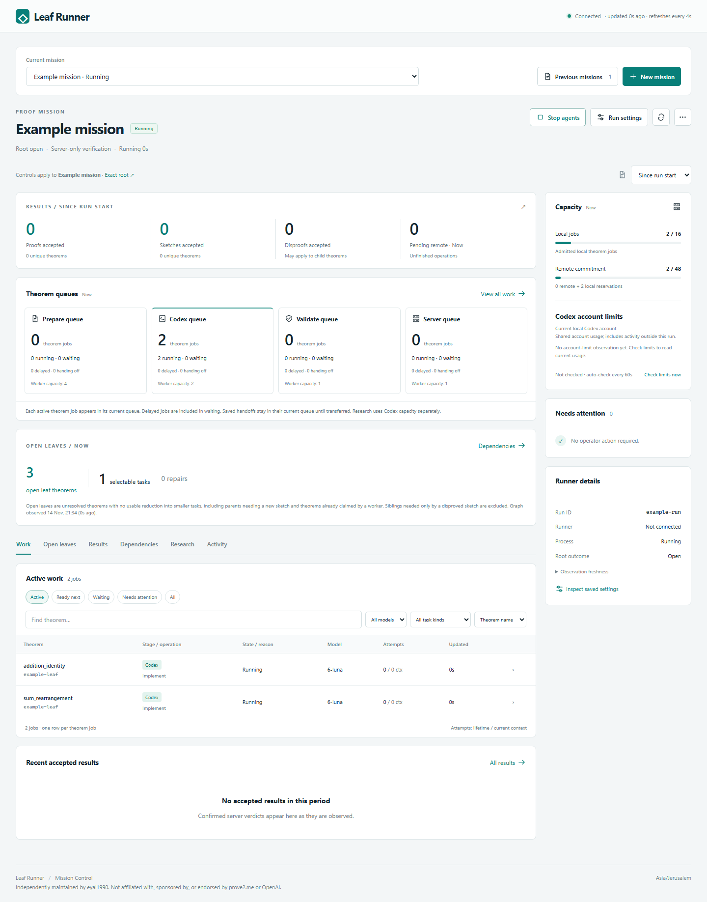

# Leaf Runner for prove2.me

Leaf Runner works on [prove2.me](https://prove2.me) missions with Codex: it finds
unresolved Lean theorems, generates proofs, reductions, or counterexample
certificates, and submits them for verification. **Mission Control**, its local
browser dashboard, is the easiest way to start, monitor, and resume work.
Automation does not guarantee a proof; Prove2.me remains the authority on results.

## Demo
https://github.com/user-attachments/assets/98f99a80-a49b-4450-bda5-1ec9e9dc7602



*The dashboard above uses synthetic example data, with no account or mission information.*

## Requirements

For the default **server-only verification** workflow:

- Node.js **22 or newer**, npm, Git, and a web browser.
- A Prove2.me account and API key with access to your mission.
- A Codex account/login that can use the configured models.
- Internet access for Prove2.me, Codex, and Git source downloads; disk space for
  downloaded Mathlib sources and private workspaces.

**Local verification** additionally needs elan with Lean/Lake available on your
PATH (check `lake --version`). The runner installs the target's pinned toolchain,
downloads its Mathlib dependencies/cache, and builds locally. Allow extra disk
space and setup time. Server-only mode needs no Lean, elan, Lake, or compiled
Mathlib cache. See [verification modes](docs/verification-modes.md) to choose.

## Quick start: clone, sign in, and run a mission

### 1. Clone and install

Open **Windows PowerShell** and run:

```powershell
git clone https://github.com/eyal1990/leaf-runner.git
cd leaf-runner
npm.cmd ci
```

The repository pins its own Codex CLI; no global Codex installation is needed.
On macOS/Linux, use the same commands with `npm` in place of `npm.cmd` throughout
this guide. On Windows, `npm.cmd` avoids PowerShell script execution-policy
problems.

### 2. Sign in and add your API key

Sign in with the installed Codex CLI and complete its login flow:

```powershell
npm.cmd run codex -- login
```

See the [official Codex authentication guide](https://learn.chatgpt.com/docs/auth)
if you need another sign-in method.

For Prove2.me, sign in at [prove2.me](https://prove2.me), open the account menu,
and choose **API key**. Launch Mission Control in the next step and paste your
key into **Connect to Prove2.me**. The dashboard saves it locally for future
runs; you do not need to create or edit files. Use **Update API key** to replace it.

For headless use, set `PROVE2ME_API_KEY` in your shell or copy
`credentials.example.json` to `credentials.json` and fill in `api_key`.
`credentials.json` is ignored by Git. `PROVE2ME_API_KEY` takes precedence over
saved credentials; when set, update it in your launcher environment and restart
Mission Control. `.env` files are not loaded automatically. Codex authentication
and the Prove2.me key are separate.

### 3. Start Mission Control and enter your mission

In the repository folder, run:

```powershell
npm.cmd start
```

On Windows, you can also double-click
**[Start Leaf Runner.cmd](Start%20Leaf%20Runner.cmd)** after installation and
authentication. Keep the launcher's terminal open. Mission Control opens in your
browser; if it doesn't, use the full local session URL printed in that terminal.
Opening the dashboard does not start proof work or resume saved missions.

1. Click **New mission** (or **Set up mission** on the welcome screen).
2. Type or paste your existing Prove2.me **mission name, mission-page URL, or
   mission ID**. Optionally enter a **Milestone** name or ID to work on just its
   linked theorem tree. Use a mission your API key can access. If you have not
   created a mission yet, create it on [prove2.me](https://prove2.me) first; this
   field selects an existing mission.
3. Leave **Start working immediately** checked and click **Set up mission**.
   The runner resolves your mission and starts working with the default settings.
4. Follow **Work**, **Open leaves**, and **Results**; click a theorem to inspect
   its statement, attempts, source, and logs.
5. To stop, choose **Mission actions → Stop and save**, then **Confirm**. Later,
   choose **Start saved run** to continue. On subsequent launches, just run
   `npm.cmd start` and select your saved mission.

To review settings before the first model call, **uncheck Start working
immediately** in step 3. Open **Run settings**, make your changes, click **Save
settings**, then **Start mission**.

**Starting a mission invokes models and can publish declarations and submit
proofs to Prove2.me.** Runs continue until the root is proved, disproved, stopped,
or encounters a fatal error. There is no fixed one-attempt mode. Capacity limits
bound parallel work, not total attempts or usage. Stopping saves local work;
already-issued server work can finish afterward. Ctrl+C in the launcher also
stops and saves before closing Mission Control.

## Optional: preview the frontier without starting work

Before a first run, check that your credentials and mission resolve correctly:

```sh
node prove2me.mjs --mission "Your mission" --list
```

Replace `Your mission` with its name, mission-page URL, or ID. This preview lists
scored open leaves and eligible parent repairs using **API reads only**: no model
invocations, proof submissions, Lean downloads, or job claims. A frontier is the
current set of unresolved tasks the runner can work on.

This one-time terminal preview is optional. The dashboard's **Open leaves** tab
shows the saved frontier after the runner observes it; registering a mission
without starting it does not fetch a frontier.

## Default configuration

The checked-in [project configuration](runner-config.json) selects **Luna High**
for proof attempts, **two Codex workers**, and **server-only verification**.
It admits up to **four local jobs** and **eight local plus remote jobs**, uses
two preparation workers, and keeps Windows recovery in protected sandbox modes.
Repeated stalled results can trigger **one Sol High rescue per stall**.
Run settings shows the selected file and lets you change models and capacities.
Saves persist and are shared by missions using that file. The optional
[example configuration](runner-config.example.json) deliberately differs
(Terra Medium, eight workers, and uncapped rescues); it is not loaded unless
selected. See the [configuration reference](docs/configuration.md) for exact values.

## Using the dashboard

The **[Mission Control user guide](docs/mission-control.md)** explains every
screen, button, filter, and Run settings field, including:

- Adding, selecting, searching, and switching saved missions.
- Starting, stopping agents, pausing new work or dispatch, and stopping/saving.
- Work queues, open leaves, results, dependencies, research, and activity.
- Models and reasoning effort, automatic escalation, and queue/job capacities.
- The theorem inspector, artifact/log controls, account limits, and report export.

One mission can run per checkout. Selecting another saved mission changes the
view; **Stop and switch** saves the active mission before starting the selected
one. Mission Control listens on `127.0.0.1` and keeps credentials on its local
server. Browser status refreshes every four seconds; **Refresh status** rereads
saved observations, rather than forcing a new platform graph scan.

## Reference and development

See the [documentation index](docs/README.md) for [verification modes](docs/verification-modes.md),
[configuration](docs/configuration.md), [scheduling](docs/scheduler.md),
[recovery and diagnostics](docs/operations.md), and architecture references.
Contributors can run `npm test` for the offline suite; optional Lean and browser
checks are described in [verification](docs/verification.md).
Report vulnerabilities through the [security policy](SECURITY.md).

Leaf Runner is independently maintained by **eyal1990**. It is not affiliated
with, sponsored by, or endorsed by prove2.me or OpenAI. Source and documentation
are released under the [MIT License](LICENSE), copyright (c) 2026 eyal1990.
Dependencies and downloaded material retain their own licenses and terms;
see [third-party notices](THIRD_PARTY_NOTICES.md).
